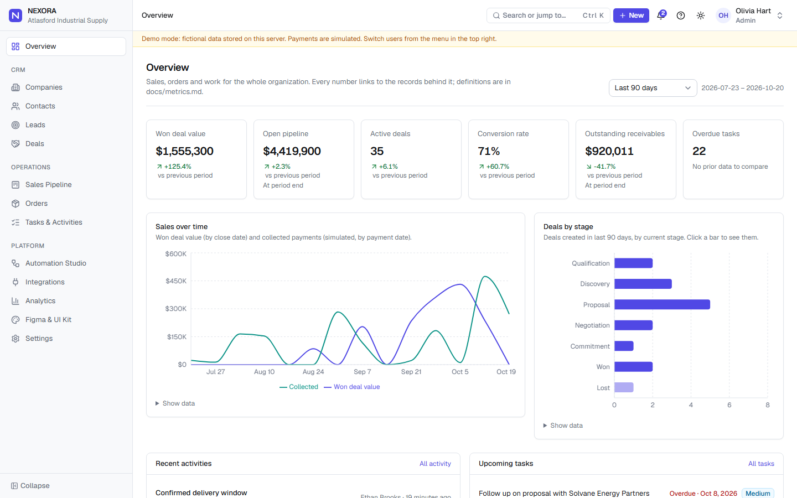
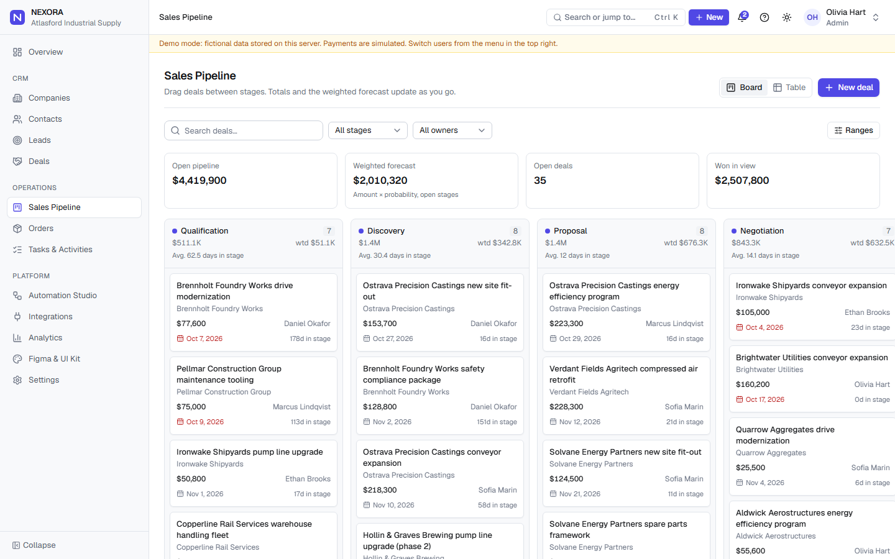
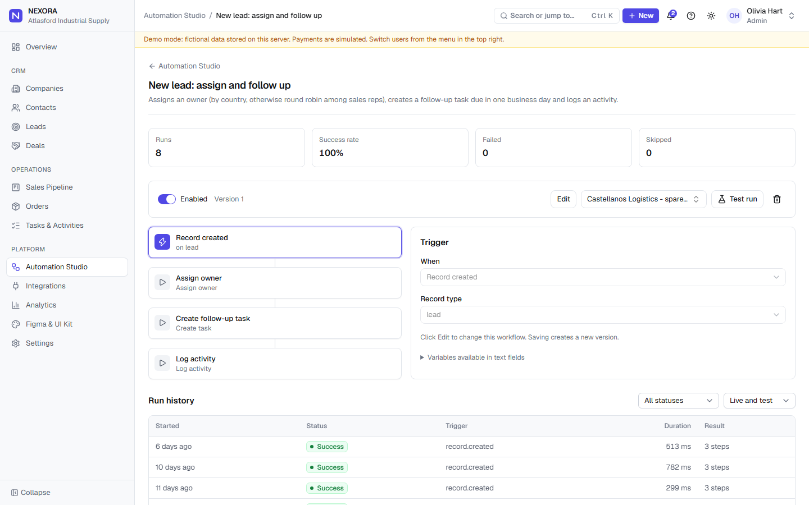
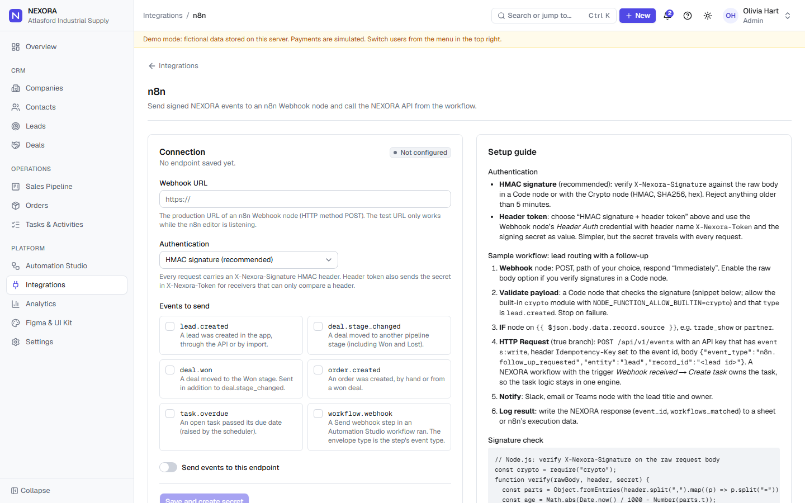
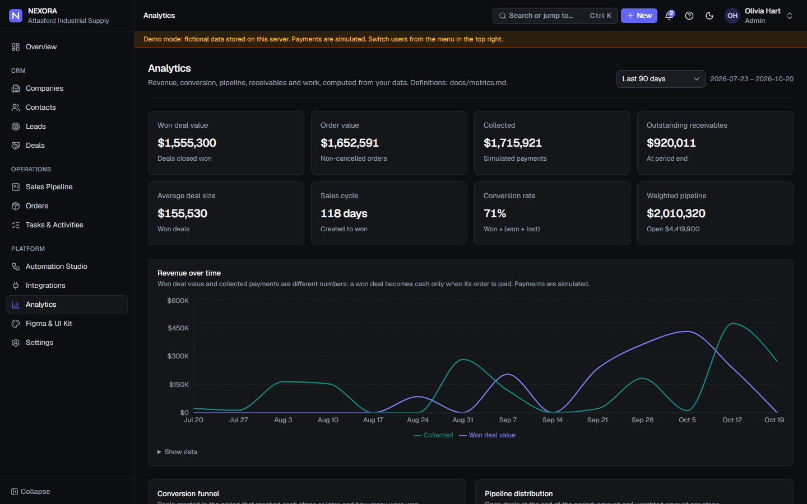
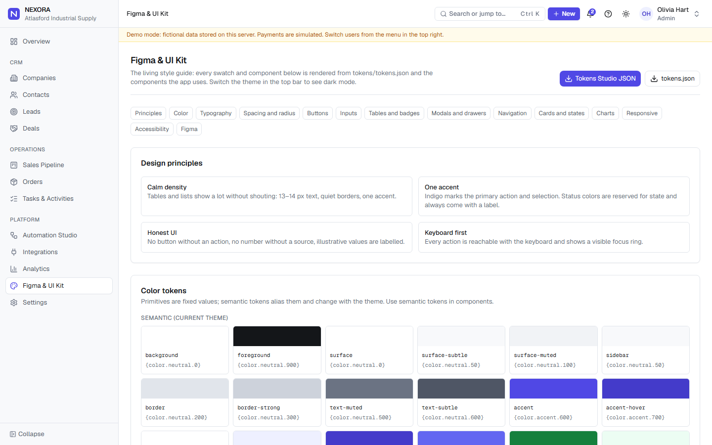

# NEXORA

> **Demo project from my portfolio.** Built and maintained by [psmoolyakov](https://github.com/softlys). All company and person data in it is fictional.

**B2B operations platform for an equipment supplier: CRM, sales pipeline, orders, workflow automation and integrations.**

NEXORA is a portfolio project built to production standards:
- one permission model, enforced on the server and in the database
- deterministic demo data
- signed webhooks
- a documented public API
- tests for the rules that matter

All company and person data is fictional.

> Status: phases 1–4 are complete. See [PROGRESS.md](PROGRESS.md) for exactly what was built and verified, and for the known limitations.

## Features

- **CRM.** Companies, contacts and leads, with URL-based search and filters, record timelines, comments and activity logging. A lead converts into a company, contact and deal, once only Every list exports to CSV with its current filters. Companies and contacts import from CSV: the file is checked first, with errors listed by row.
- **Sales pipeline.** A kanban board with drag and drop and full keyboard support. Moves are optimistic with rollback. It also covers lost reasons, quick edits, a weighted forecast and full deal change history.
- **Orders.**
  - A line-item editor with enforced status transitions.
  - Simulated payments and a derived payment status.
  - A won deal becomes exactly one order.
- **Tasks and activities.** List, month and week calendar views, one-click completion, and an activity feed.
- **Dashboard and analytics.** Revenue, pipeline, conversion, receivables ageing, sales by owner and source, and task completion. Every metric is computed from data and defined in [docs/metrics.md](docs/metrics.md). Periods live in the URL, values are compared with the previous period, and charts drill down to the records behind them.
- **Automation Studio.**
  - No-code workflows: triggers, conditions, tasks, notifications, owner assignment, deal to order, email, webhooks and delays.
  - Each workflow is validated and versioned, and supports test runs.
  - Run history with retry from the failed step.
  - Guardrails against loops and runaway runs.
- **Connectors.** Each is configured on the server and documented in [docs/integrations.md](docs/integrations.md). Most work from Russia:
  - Obsidian vault export (also kept on Yandex Disk);
  - personal calendar feeds for Google, Yandex and Outlook;
  - Tilda and Yandex Forms → leads;
  - Mango Office, Zadarma and Twilio calls;
  - Yandex 360 and Gmail mail on timelines;
  - WhatsApp Business;
  - an AI deal assistant (YandexGPT or Claude);
  - printable invoices and quotes;
  - ЮKassa and Stripe payment links;
  - Yandex Telemost meetings;
  - МойСклад products;
  - Slack and Notion steps.
- **Integrations.**
  - Outbound webhooks for Make, n8n and any HTTPS endpoint, signed with HMAC-SHA256 and protected against SSRF.
  - Retries with backoff, a delivery log and redelivery.
  - Statuses are honest: an integration shows Connected only after a real test event succeeded.
- **Public API** at `/api/v1`.
  - Org API keys, stored hashed and limited by scopes.
  - Zod validation, `Idempotency-Key` support and per-key rate limits.
  - An OpenAPI 3.1 document generated from the same schemas the server validates with, plus an in-app reference.
- **Security telemetry.** A tamper-evident, hash-chained security log with in-app verification. A security API lets the companion SIEM, [VIGIL](https://github.com/softlys/vigil), read the log and respond: revoke a key or disable a user.
- **Design system.** Tokens drive every color and size. The living style guide at `/ui-kit` is rendered from the real components, and the tokens export to Tokens Studio for Figma.
- **Roles.** Admin, Manager and Sales Rep. Navigation, direct URLs, server actions, the API and row-level security all follow the same permission matrix.

## Quick start (demo mode)

```bash
npm install
npm run dev
```

Open http://localhost:3000. No environment variables are needed. Use the user menu in the top right to act as a different role. For a five-minute tour to show a client, see [docs/demo-guide.md](docs/demo-guide.md).

## Architecture

```mermaid
flowchart LR
  Browser[Browser] -->|server actions| Actions[Server actions<br/>Origin check, rate limit, Zod, can()]
  Client[Make / n8n / forms / VIGIL] -->|/api/v1 + API key| API[API pipeline<br/>key hash, scopes, Zod, idempotency]
  Actions --> Services[Domain services<br/>src/server/services]
  API --> Services
  Services --> Db[(Tx: demo store or<br/>Supabase with RLS)]
  Services -->|events| Bus{{Event bus}}
  Bus --> Audit[audit_logs]
  Bus --> SecLog[security_events<br/>hash chain]
  Bus -->|after commit| Engine[Automation engine]
  Engine --> Services
  Engine -->|after response| Webhooks[Signed webhooks<br/>SSRF-safe transport]
  Cron[Cron every 5 min] --> Scheduler[Scheduler: due dates,<br/>delays, retries, heartbeat]
  Scheduler --> Engine
```

See [docs/architecture.md](docs/architecture.md) for the layers, the request lifecycle and the main decisions.

## Tech stack

Next.js 16 (App Router) · React 19 · TypeScript (strict) · Tailwind CSS 4 · shadcn/ui · Lucide · Recharts · React Hook Form + Zod · dnd-kit · Supabase (PostgreSQL, Auth, RLS) · Vitest · Playwright · PGlite (migration and RLS tests)

## Screenshots

Real screenshots of the demo build (fictional data), taken with Playwright.

| Overview | Sales pipeline |
| --- | --- |
|  |  |
| **Automation Studio** | **Integrations: n8n** |
|  |  |
| **Analytics (dark)** | **UI kit** |
|  |  |

## Scripts

| Command | What it does |
| --- | --- |
| `npm run dev` | Start the dev server |
| `npm run build` / `npm start` | Production build and server |
| `npm run lint` | ESLint |
| `npm run typecheck` | Generate route types and run `tsc --noEmit` |
| `npm test` | Vitest unit and integration tests, including migrations and RLS on PGlite |
| `npm run test:e2e` | Playwright end-to-end tests against a production build (run `npx playwright install chromium` once) |
| `npm run demo:seed` | Create the demo dataset if it does not exist |
| `npm run demo:reset` | Replace the demo dataset with a fresh seed |
| `npm run supabase:seed` | Load the demo dataset and demo users into Supabase |
| `npm run tokens:build` | Regenerate CSS variables from `tokens/tokens.json` |

## Supabase mode

1. Create a Supabase project and apply the migrations: `supabase link`, then `supabase db push`.
2. Copy `.env.example` to `.env.local` and set these variables:
   - `NEXT_PUBLIC_SUPABASE_URL`
   - `NEXT_PUBLIC_SUPABASE_ANON_KEY`
   - `SUPABASE_SERVICE_ROLE_KEY`
   - `NEXORA_ENCRYPTION_KEY`
   - `DEMO_USER_PASSWORD`
3. Load the demo data and users: `npm run supabase:seed`.
4. Set `NEXORA_DATA_MODE=supabase`, run `npm run dev`, and sign in as one of the printed demo accounts.

Deployment to Vercel, the cron setup and all environment variables are covered in [docs/deployment.md](docs/deployment.md); Docker on your own server in [docs/self-hosting.md](docs/self-hosting.md).

## Integration guides

- [Make](docs/make-integration.md): new lead → custom webhook → Slack or email → call back to NEXORA
- [n8n](docs/n8n-integration.md): signed webhook → validate → IF → NEXORA API → notify → log
- [Public API](docs/api.md): keys, scopes, endpoints, errors, idempotency, the SIEM API
- [Automation guide](docs/automation-guide.md): workflows, steps, limits, scheduler

## Documentation

| Document | Contents |
| --- | --- |
| [architecture.md](docs/architecture.md) | Layers, request lifecycle, events, engines, decisions |
| [data-model.md](docs/data-model.md) | Tables, relationships, ER diagram, migrations |
| [security.md](docs/security.md) | Roles, permission matrix, RLS, threats and controls, demo-mode limits |
| [security-events.md](docs/security-events.md) | Security event schema, hash chain, action catalog (contract with VIGIL) |
| [metrics.md](docs/metrics.md) | Definition of every metric |
| [automation-guide.md](docs/automation-guide.md) | Workflows, triggers, steps, limits, scheduler |
| [api.md](docs/api.md) | Public API reference and conventions |
| [make-integration.md](docs/make-integration.md), [n8n-integration.md](docs/n8n-integration.md) | Step-by-step integration guides |
| [figma-design-system.md](docs/figma-design-system.md) | Tokens, Tokens Studio import, Figma file structure |
| [deployment.md](docs/deployment.md) | Vercel + Supabase, cron, environment variables |
| [self-hosting.md](docs/self-hosting.md) | Docker on your own server, TLS, backups, upgrades, rollback |
| [integrations.md](docs/integrations.md) | Obsidian, calendars, web forms, telephony, mail, WhatsApp, AI, payments, Yandex 360, MoySklad, Slack, Notion |
| [demo-guide.md](docs/demo-guide.md) | A five-minute click path for showing the product |
| [PROGRESS.md](PROGRESS.md) | Build log, verification results, known issues, decisions |

## Known limitations

- Demo mode stores data in a local file. On serverless hosts it does not persist between cold starts.
- In demo mode anyone can switch to any demo user. Never put real data in a demo instance.
- Rate limits and the bulk-read detector are in memory, per server instance. A multi-instance deployment needs a shared store.
- The Supabase adapter and RLS are tested against PostgreSQL via PGlite with a stubbed `auth` schema. They have not been run against a live Supabase project in this repository's checks.
- Email is supported through Resend only; there is no SMTP.
- No Make blueprint or n8n workflow file is shipped, because their formats could not be verified for this release. The guides describe how to build both scenarios.

## Roadmap

- Shared rate-limit store (Upstash/Redis) for multi-instance deployments.
- Webhook delivery through a durable queue instead of the request and scheduler.
- Import and export of records (CSV).
- Real payment provider integration behind the simulated payments.
- Further VIGIL detections as NEXORA logs more activity (successful API key use, sign-ins in demo mode).

## License

[MIT](LICENSE)
