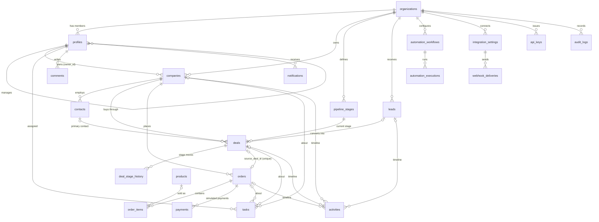

# Data model

NEXORA stores everything in PostgreSQL (Supabase) or, in demo mode, in a server-side JSON file with the same shape.
The schema is defined in `supabase/migrations/` and mirrored by the Zod schemas in `src/domain/entities.ts`.

## Conventions

- Every business table has `organization_id`. Core relations use **composite foreign keys** `(id, organization_id)`, so a row can never reference a record in another organization, even if application code has a bug.
- `created_at` and `updated_at` on every mutable table; `updated_at` is maintained by a trigger.
- `archived_at` marks soft-deleted records. Lists hide archived rows; hard delete is admin-only.
- Ownership: `owner_id` (companies, contacts, leads, deals, orders) or `assignee_id` (tasks) drives visibility. See [security.md](security.md).
- Money is `numeric(14,2)`; percentages are `numeric(5,2)` or integers.
- Enumerations are `text` with `check` constraints, so adding a value is a small migration.

## Entity relationships

## Tables

| Table | Purpose | Notable constraints |
| --- | --- | --- |
| `organizations` | Tenant. Currency, locale, `settings.order_conversion_mode` (`draft` or `confirmed`). | `slug` unique |
| `profiles` | One per Supabase Auth user. `role` is `admin`, `manager` or `sales_rep`; `manager_id` defines the team. | Role changes only through `change_profile_role()` |
| `companies` | Customer and prospect accounts. | `size`, `lifecycle_stage` enumerations |
| `contacts` | People at companies. `tags` text array. | Company must be in the same organization |
| `leads` | Interest that is not a deal yet. | `converted_deal_id` unique: a lead converts once |
| `email_templates` | Ready-made e-mails for "Write e-mail" on record pages, with `{{entity.field}}` variables. | Members read, admins manage |
| `pipelines` | Sales pipelines (воронки), each with its own stages; the first by position is the default. | Name unique per org; the last pipeline and pipelines with deals cannot be deleted |
| `pipeline_stages` | Ordered stages of a pipeline with default probability and won/lost flags. | Position and name unique per pipeline; exactly one won and one lost stage per pipeline, enforced by the stage functions |
| `custom_fields` | Admin-defined fields (text, number, date, list, yes/no, link) on companies, contacts, leads and deals. Values live in each record's `custom` jsonb object, keyed by the field key and validated by the services. | `(organization_id, entity, key)` unique; members read, admins manage; archived fields keep their values on records |
| `deals` | Opportunities. `probability` defaults from the stage. | `lead_id` unique |
| `deal_stage_history` | Every stage move with who and when. | |
| `products` | Catalog. | `sku` unique per organization |
| `orders` | Orders with stored totals and derived payment status. | `source_deal_id` **unique**: one order per deal, which makes deal-to-order conversion idempotent; `order_number` unique per org |
| `order_items` | Lines with quantity, unit price, discount and tax. | |
| `payments` | Simulated payments only. | `is_simulated` must be `true` |
| `tasks` | Work items with priority, status, due date and links to records. | |
| `activities` | Calls, meetings, emails, notes, follow-ups and system events. | |
| `comments` | Comments on companies, contacts, leads, deals, orders or tasks. | |
| `notifications` | Per-user notifications. | `(organization_id, dedupe_key)` unique so automations never notify twice |
| `automation_workflows` | Workflow definitions (JSON, validated in phase 3). | |
| `automation_executions` | One row per run with step results. | `(organization_id, idempotency_key)` unique: a repeated event returns the earlier execution |
| `integration_settings` | Make, n8n, generic webhook and email configuration. | Signing secret encrypted (AES-256-GCM) plus hash; both hidden from the client role. One per provider |
| `webhook_deliveries` | Every outbound webhook attempt. | |
| `api_keys` | Hashed API keys with scopes. | `key_hash` unique, hidden from the client role |
| `audit_logs` | Who changed what, with before/after, IP, user agent and request id. | Append-only for the application |
| `api_idempotency_keys` | Stored responses for POST requests with an `Idempotency-Key` (24 hours). | `unique (api_key_id, key)`; no client access |
| `security_events` | Security telemetry for the SIEM: per-organization hash chain ([security-events.md](security-events.md)). | Insert-only; `unique (organization_id, sequence)` |

## Migrations

| File | Contents |
| --- | --- |
| `20261019000001_core_schema.sql` | Tables, composite tenant keys, indexes, `updated_at` triggers |
| `20261019000002_row_level_security.sql` | RLS helpers and policies, column grants |
| `20261019000003_admin_functions.sql` | Role changes and pipeline stage editing with invariants |
| `20261020000001_crm_core.sql` | `next_order_number()` (numbers orders across the organization even though RLS hides other users' orders), list/search indexes |
| `20261022000001_integrations_api.sql` | Encrypted integration secrets (`secret_ciphertext`, `secret_preview`, one integration per provider), delivery `reason` and retry index, `api_idempotency_keys` (server-only, 24 h), API key prefix index |
| `20261026000001_pipelines.sql` | `pipelines`, `pipeline_stages.pipeline_id`, per-pipeline stage functions, `create_pipeline()` / `rename_pipeline()` / `delete_pipeline()` |
| `20261026000002_custom_fields.sql` | `custom_fields` with RLS, `custom jsonb` (object) on companies, contacts, leads and deals |
| `20261026000003_email_templates.sql` | `email_templates` with RLS and the default templates for existing organizations |
| `20261026000004_telephony.sql` | `profiles.phone_extension` (internal PBX number) and its column grant |
| `20261021000001_security_events_and_automation.sql` | `security_events` (hash chain, unique `(organization_id, sequence)`, insert-only), `automation_executions.resume_at` / `resume_step_id` for delayed runs, `set_profile_active()` for disabling users |

## Derived values

- **Order totals** are computed in `src/domain/orders/totals.ts` (discount before tax, rounded per line) and stored on the order.
- **Payment status** is derived in `src/domain/orders/payment-status.ts` from collected simulated payments, the total, the order status and the due date.
- **Last interaction** for a contact is the latest non-system activity linked to it (`src/domain/timeline.ts`).
- **Order numbers** are `NX-YYYY-NNNN`, sequential per organization and year (`src/domain/rules/orders.ts`, `next_order_number()` in SQL).
- **Deal probability** defaults to the stage probability and resets on every stage move; it can be overridden per deal.

## Seed data

`src/domain/seed/generate.ts` produces a deterministic, fictional dataset: one equipment supplier, 5 users, 25 companies, 2–4 contacts each, 40 leads, 60 deals across all stages with 12 months of stage history, 20 products, 40 orders with items and simulated payments, 80 tasks, activity history, comments and notifications.
All dates are offsets from "now". In demo mode the stored dataset is shifted forward by whole days when it is loaded on a later day, so the timeline always looks current.
The same generator feeds demo mode (`npm run demo:reset`) and Supabase (`npm run supabase:seed`).
Domains use the reserved `.example` TLD and phone numbers use the 555 fictional range.
